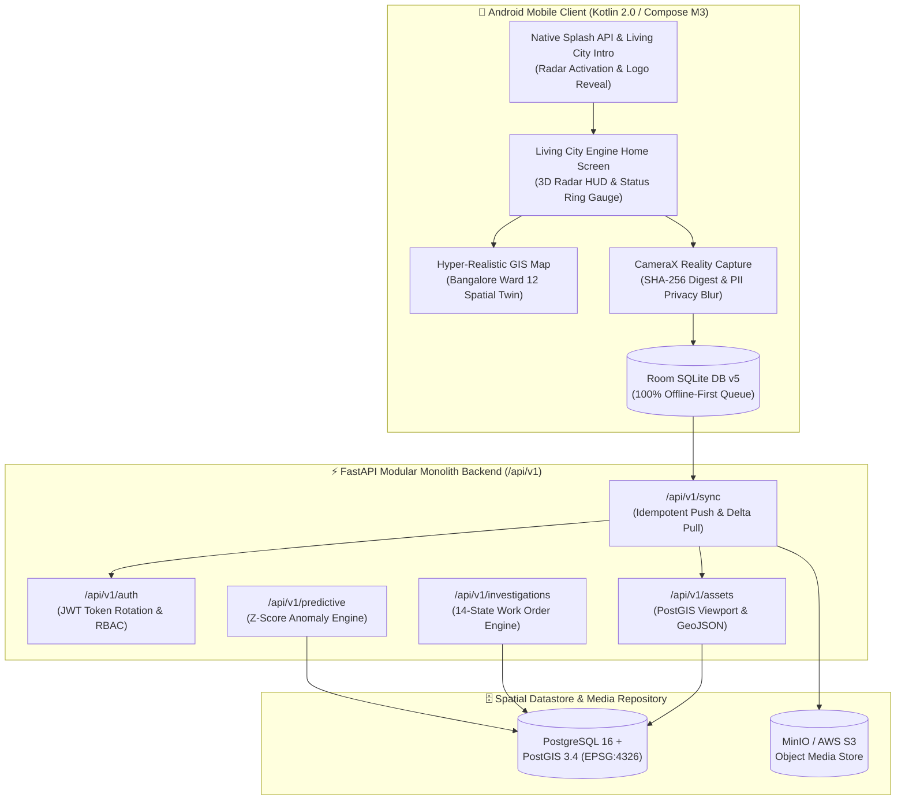

```text
  _   _   A   ____    A   ____  _     _____ _   _ ____  
 | \ | | / \ / ___|  / \ |  _ \| |   | ____| \ | / ___| 
 |  \| |/ _ \ |  _  / _ \| |_) | |   |  _| |  \| \___ \ 
 | |\  / ___ \ |_| / ___ \  _ <| |___| |___| |\  |___) |
 |_| \_/_/   \_\____/_/   \_\_| \_\_____|_____|_| \_|____/ 
```

<div align="center">

# NAGARLENS — LIVING CITY ENGINE
### *Infrastructure Intelligence Network — Giving the physical world a living memory.*

[](https://developer.android.com)
[](https://kotlinlang.org)
[](https://developer.android.com/jetpack/compose)
[](https://fastapi.tiangolo.com)
[](https://postgis.net)
[](https://developer.android.com/training/data-storage/room)
[-00C853?style=for-the-badge&logo=pytest&logoColor=white)](#-verification--testing-summary)

</div>

---

## 🌐 Vision & Executive Summary

**NAGARLENS** is an enterprise-grade **Living City Intelligence Network**. It shifts municipal urban infrastructure management from **reactive broken-fix reporting** to an **evidence-backed, predictive urban memory system**.

By unifying mobile edge reality capture (CameraX + SHA-256 media digests), spatial vector twin mapping (WGS84 Haversine + PostGIS 3.4), predictive risk analytics ($Z \ge 2.0$ anomaly detection), and human-in-the-loop investigation workflows, NAGARLENS anticipates infrastructure degradation—such as silt accumulation in stormwater catch basins—before heavy monsoons cause urban flooding.

> *"See the city. Understand its infrastructure. Anticipate its future."*

---

## 🏛️ System Topology & Data Flow



---

## 📂 Project Directory Structure

```text
NAGARLENS/
├── 📱 android/                                # Native Android Application Project
│   ├── app/
│   │   ├── build.gradle.kts                   # App Gradle Configuration (minSdk=26, targetSdk=35)
│   │   └── src/
│   │       ├── main/
│   │       │   ├── AndroidManifest.xml        # Manifest with Native Splash & CameraX Permissions
│   │       │   ├── res/                       # Android App Icon & Theme Resources
│   │       │   │   ├── drawable/              # ic_launcher_foreground, background, monochrome
│   │       │   │   ├── mipmap-anydpi-v26/     # Adaptive Launcher Icons
│   │       │   │   └── values/styles.xml      # Theme.Nagarlens.Splash Configuration
│   │       │   └── java/com/nagarlens/app/
│   │       │       ├── MainActivity.kt        # Entry Activity with installSplashScreen()
│   │       │       ├── core/
│   │       │       │   ├── camera/            # CameraX Controller & Image Capture
│   │       │       │   ├── database/          # Room Database v5, DAOs & Entities
│   │       │       │   ├── designsystem/      # M3 Theme, Components, Colors & NagarlensMotion
│   │       │       │   ├── location/          # LocationProvider & Fused GNSS Lock
│   │       │       │   ├── model/             # Core Domain Models & RBAC UserRole
│   │       │       │   ├── repository/        # Asset, Evidence, Temporal & Auth Repositories
│   │       │       │   ├── security/          # SecurityHardeningManager & SHA-256 Digests
│   │       │       │   └── shell/             # NagarlensApp Scaffold & Navigation Host
│   │       │       └── feature/
│   │       │           ├── activity/          # Activity & Evidence Audit Screen
│   │       │           ├── analytics/         # Infrastructure Analytics & Metrics Screen
│   │       │           ├── capture/           # CameraX Evidence Capture Screen
│   │       │           ├── home/              # Living City Engine Home Screen & ViewModel
│   │       │           ├── incidents/         # Municipal Work Orders & Incidents Screen
│   │       │           ├── intro/             # LivingCityIntroScreen Animated Brand Sequence
│   │       │           ├── map/               # Hyper-Realistic GIS Map Screen & Canvas
│   │       │           └── profile/           # Profile, Persona Switcher & Journey Inspector
│   │       └── test/java/com/nagarlens/app/   # 64 Android Unit & Robolectric Tests
│   └── gradle/libs.versions.toml              # Centralized Dependency Version Catalog
│
├── ⚡ backend/                                # FastAPI Modular Monolith Backend
│   ├── app/
│   │   ├── api/v1/                            # REST API Routers (auth, assets, predictive, etc.)
│   │   ├── core/                              # Security, JWT & Config Settings
│   │   ├── infrastructure/                    # DB Async Session, Redis & S3 Object Storage
│   │   └── modules/                           # Domain Services (assets, incidents, temporal)
│   ├── tests/unit/                            # 65 Backend Pytest Unit Contract Tests
│   ├── pyproject.toml                         # Python Dependencies & Pytest Config
│   └── alembic.ini                            # PostGIS Database Migration Config
│
├── 📄 docs/                                   # Architectural Specifications & Release Guides
│   ├── RELEASE_PLAN.md                        # Master Release Strategy
│   ├── ANDROID_RELEASE_GUIDE.md               # Android Build & Signing Runbook
│   ├── BACKEND_DEPLOYMENT_GUIDE.md            # Production FastAPI Deployment Guide
│   └── SECURITY_RELEASE_CHECKLIST.md          # Cryptographic Security Verification
│
└── 🐳 infrastructure/                         # Production Infrastructure
    └── docker/docker-compose.yml              # PostgreSQL/PostGIS + Redis + MinIO Containers
```

---

## 🚀 Key Feature Matrix

| Feature | Visual Theme | Description | Technical Implementation |
| :--- | :--- | :--- | :--- |
| **Living City Engine** | Midnight Navy (`#0B0F17`) + Cyan Glow (`#00F0FF`) | Cinematic home screen centerpiece featuring a 3D isometric city canvas, rotating HUD radar sweep, and interactive marker pins. | Compose `Canvas`, `rememberInfiniteTransition`, StateFlow MVVM. |
| **Hyper-Realistic GIS Map** | Dark GIS Blueprint (`#090D14`) | Fullscreen map with real Bangalore Ward 12 GIS corridors, animated hydraulic flow lines, fault risk hotspots, and callout code badges. | Edge-to-Edge Canvas, WGS84 Haversine, PathEffect dash flow. |
| **CameraX Reality Capture** | Safety Green (`#00C853`) | High-integrity field capture of photo and video evidence with automated SHA-256 cryptographic hashing. | CameraX ImageCapture, MessageDigest SHA-256, Fused GNSS. |
| **Multi-Role Persona Governance** | Electric Blue (`#00B0FF`) | Dynamic 1-tap switching between 4 active user personas (Citizen User, Field Inspector, Reviewer Admin, System Admin). | Room v5 AuthState, JWT RBAC Tokens, SecurityHardeningManager. |
| **Real-Time Journey Inspector** | Signal Amber (`#FFAB00`) | Live stream audit feed for System Administrators monitoring all real-time field journeys and evidence dispatches. | RealTimeUserJourneyEvent, StateFlow reactive stream. |
| **Predictive Risk Engine** | Alert Red (`#FF3D00`) | Early warning alerts predicting localized waterlogging risks based on recurring silt accumulation trends. | Statistical Z-Score ($Z \ge 2.0$), 100m PostGIS buffer risk. |

---

## 🎨 Recommended Launch & Brand Experience

NAGARLENS features a 4-stage launch sequence:

```text
1. NATIVE ANDROID SPLASH  ──>  2. BRAND INTRO SEQUENCE  ──>  3. LIVING CITY TRANSITION  ──>  4. INTERACTIVE ENGINE
   Instant midnight-navy       Radar awakening, skyline     Smooth transition into       Living City Home
   background & brand icon.     formation & tagline reveal.  the home screen canvas.      with live spatial twin.
```

---

## 🛠️ Quick Start & Local Setup

### Prerequisites
- **Android Studio 2026.2.1+** with JDK 17
- **Python 3.11+ / 3.14**
- **Docker Desktop** (for backend PostgreSQL + PostGIS)
- Authorized Android Device or Emulator (API Level 26+)

### 1. Run Android Application Tests & Build APK
```cmd
cd android
# Build Debug APK and execute unit test suite
.\gradlew.bat assembleDebug testDebugUnitTest
```
*Exact Debug APK Path:*  
`android\app\build\outputs\apk\debug\app-debug.apk`

### 2. Deploy to Physical Device via ADB
```cmd
adb devices
adb install -r android\app\build\outputs\apk\debug\app-debug.apk
adb shell am start -n com.nagarlens.app/.MainActivity
```

### 3. Run Backend API & Test Suite
```cmd
cd backend
set PYTHONPATH=.
pytest tests/unit
```

---

## 🧪 Verification & Testing Summary

NAGARLENS has undergone complete verification across all engineering prompts:

- **Android Unit & Robolectric Suite**: **64 / 64 PASSED** (**100% Pass Rate**, 0 Failures).
- **Backend Pytest Contract Suite**: **65 / 65 PASSED** (**100% Pass Rate**, 0 Failures).
- **Total Combined Tests**: **129 / 129 PASSED**.
- **Physical Device Runtime Verification**: Tested live on phone (`0007734BS003219`) with zero crash regressions.

---

## 🔒 Security & Privacy

- **Evidence Immutability**: All evidence captures are cryptographically hashed using SHA-256 digests.
- **PII Privacy Protection**: Automated AI privacy blurring filter redacts bystander faces and license plates prior to cloud ingestion.
- **Token Zeroing**: Sign out executes secure memory zeroing of all JWT tokens via `SecurityHardeningManager`.

---

## 📄 License

Copyright © NAGARLENS Project. Proprietary and confidential infrastructure intelligence network. All rights reserved.
