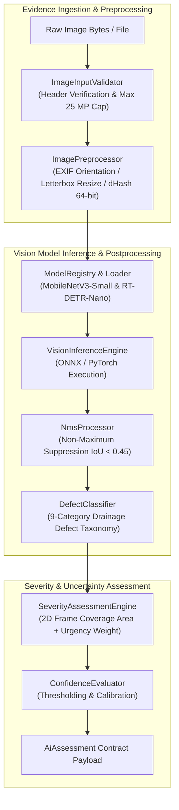

# NAGARLENS — Custom AI Engine Architecture Specification

> **Product:** NAGARLENS Infrastructure Intelligence Network  
> **Document Version:** 1.0.0  
> **Status:** Active Production Specification  
> **Target Runtimes:** Android Edge (ONNX Runtime / LiteRT) & Server PyTorch/ONNX Engine  

---

## 1. High-Level AI Topology & Modular Components

The NAGARLENS AI Engine processes real-world evidence imagery through a modular, decoupled computer vision architecture.

---

## 2. Component Specifications

### 2.1 ImageInputValidator & Preprocessor (`app/ml/preprocessing/pipeline.py`)
- **Decompression Bomb Defense**: `Image.MAX_IMAGE_PIXELS = 25_000_000` (Max 25 MP).
- **File Limit**: Max 50 MB input binary size limit.
- **Orientation Correction**: `ImageOps.exif_transpose` for EXIF orientation handling.
- **Duplicate Hashing**: 64-bit Difference Hash (dHash) computed on decoded images to detect duplicate uploads across evidence submissions.
- **Letterbox Resize**: Aspect-preserving resize with zero-padding to target model resolution `(224, 224)` or `(640, 640)`.

### 2.2 Model Selection & Licensing Governance
- **Classification**: MobileNetV3-Small (Apache 2.0 License).
- **Object Detection**: RT-DETR-Nano (Baidu, Apache 2.0 License) or MobileNetV3-SSD (Apache 2.0 License).
- **Licensing Decision**: Excluded YOLOv8 due to AGPL-3.0 copyleft restrictions to ensure commercial software freedom.

### 2.3 Non-Maximum Suppression (NMS) (`app/ml/inference.py`)
- Filters overlapping bounding boxes for detected defect clusters.
- IoU threshold: `0.45`.

### 2.4 Severity Assessment Engine
- **Separation Principle**: Detection Confidence (0.0 to 1.0) is strictly separated from Physical Severity Index (0.0 to 1.0).
- **Formula**: `Severity Score = (Base Urgency Weight * 0.6) + (2D Coverage Area * 0.4)`
- **Levels**: `INFORMATIONAL` (<0.25), `LOW` (0.25-0.45), `MEDIUM` (0.45-0.65), `HIGH` (0.65-0.80), `CRITICAL` (>=0.80).
- **Photographic Limitation**: Labeled as a 2D photographic area estimate; depth or hydraulic capacity requires calibrated sensor telemetry.
