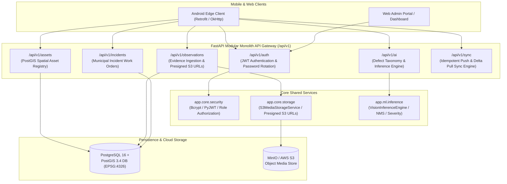

# NAGARLENS — Backend & Cloud Platform Architecture Specification

> **Product:** NAGARLENS Infrastructure Intelligence Network  
> **Document Version:** 1.0.0  
> **Status:** Active Production Specification  
> **Framework:** FastAPI Python 3.12+ (Modular Monolith)  

---

## 1. High-Level Modular Monolith Topology

The NAGARLENS Backend Platform is structured as a **Modular Monolith** (`app.modules.*`), combining REST API v1 routers, async SQLAlchemy 2.0 ORM datastores, S3-compatible media object storage, and AI inference gateways.

---

## 2. API Router Index (`/api/v1`)

| Router Path | Module | Endpoints | Security Requirement |
| :--- | :--- | :--- | :--- |
| `/api/v1/health` | Health & Diagnostics | `GET /live`, `GET /ready` | Public |
| `/api/v1/auth` | Authentication | `POST /register`, `POST /token`, `POST /refresh`, `GET /me` | Bearer Token for `/me` |
| `/api/v1/assets` | Asset Registry | `POST /`, `GET /{id}`, `GET /`, `GET /nearby`, `PATCH /{id}`, `POST /{id}/verification` | Bearer Token / Reviewer Role |
| `/api/v1/observations` | Evidence Ingestion | `POST /`, `GET /{id}`, `POST /upload-url` | Bearer Token |
| `/api/v1/incidents` | Incident Work Orders | `POST /`, `GET /{id}`, `GET /`, `PATCH /{id}/status` | Bearer Token |
| `/api/v1/sync` | Data Sync Engine | `POST /push`, `GET /pull` | Bearer Token |
| `/api/v1/ai` | AI Vision Engine | `GET /taxonomy`, `GET /models`, `POST /assessments` | Public / Bearer Token |
| `/api/v1/temporal` | Reality Graph | `POST /assets/{id}/observations`, `GET /assets/{id}/timeline` | Bearer Token |
