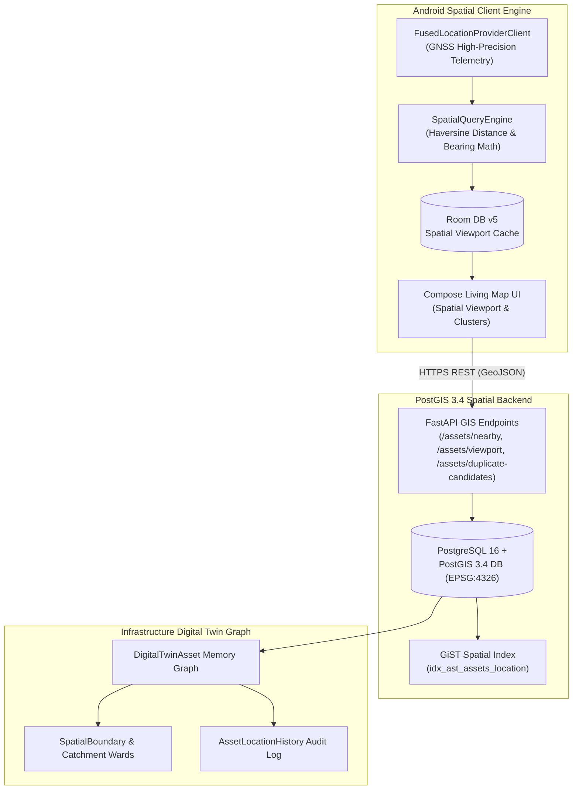

# NAGARLENS — Geospatial Engine & GIS Architecture Specification

> **Product:** NAGARLENS Infrastructure Intelligence Network  
> **Document Version:** 1.0.0  
> **Status:** Active Production Architecture  
> **Spatial Reference System:** WGS84 (EPSG:4326) / Web Mercator (EPSG:3857)  

---

## 1. High-Level Spatial Architecture Topology

The NAGARLENS Geospatial Intelligence Engine connects physical infrastructure assets, GNSS location telemetry, spatial queries, PostGIS geometry datastores, and digital twin memory graphs.

---

## 2. Spatial Query Engine (`SpatialQueryEngine.kt`)

The Android edge client features a mathematically verified geodesic calculation engine:
1. **Geodesic Distance (Haversine Formula)**:
   $$d = 2R \arcsin\left(\sqrt{\sin^2\left(\frac{\Delta \phi}{2}\right) + \cos(\phi_1)\cos(\phi_2)\sin^2\left(\frac{\Delta \lambda}{2}\right)}\right)$$
2. **Compass Bearing Calculation**:
   $$\theta = \text{atan2}\left(\sin(\Delta \lambda)\cos(\phi_2), \cos(\phi_1)\sin(\phi_2) - \sin(\phi_1)\cos(\phi_2)\cos(\Delta \lambda)\right)$$
3. **Bounding Box Calculation**: Calculates exact minimum and maximum latitude/longitude coordinates given a center point and search radius in meters.
4. **Distance-Based Spatial Clustering**: Groups dense asset nodes into cluster centroids for zoom-level rendering optimization.
