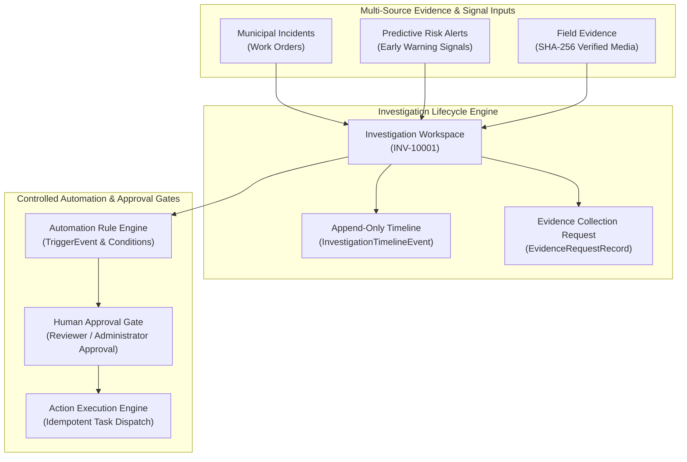

# NAGARLENS — Investigation Engine Architecture Specification

> **Product:** NAGARLENS Infrastructure Intelligence Network  
> **Document Version:** 1.0.0  
> **Status:** Active Production Specification  

---

## 1. High-Level Investigation Engine Topology

The Investigation Engine links field evidence collections, computer vision defect findings, predictive risk signals, municipal work order incidents, human approval gates, and controlled action executions into a unified investigation workspace.

---

## 2. Component Index

- **`InvestigationStatus`**: 14-state lifecycle state machine (`DRAFT`, `OPEN`, `TRIAGED`, `INVESTIGATING`, `AWAITING_EVIDENCE`, `AWAITING_REVIEW`, `ACTION_PROPOSED`, `AWAITING_APPROVAL`, `ACTION_IN_PROGRESS`, `RESOLUTION_REVIEW`, `RESOLVED`, `CLOSED`, `REJECTED`, `REOPENED`).
- **`TimelineEventSchema`**: Immutable append-only audit event history.
- **`AutomationRuleSchema`**: Versioned trigger-condition-action definitions.
- **`ApprovalRequestSchema`**: Mandatory human-in-the-loop approval gate.
