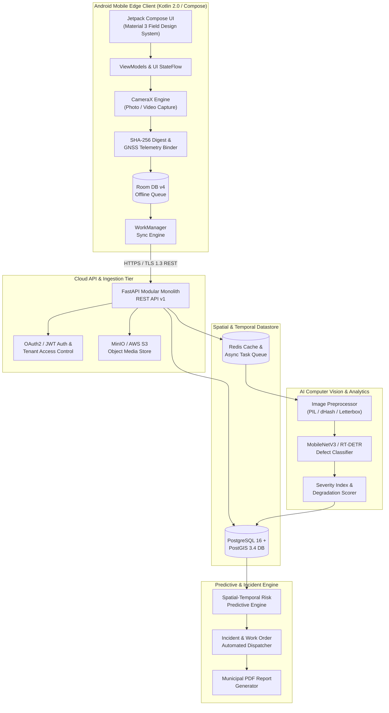

# NAGARLENS — Complete Target Architecture & Reconstruction Blueprint

> **Product:** NAGARLENS Infrastructure Intelligence Network  
> **Document Version:** 1.0.0  
> **Status:** Final Architectural Specification  

---

## 1. Executive System Topology

NAGARLENS is an end-to-end Infrastructure Intelligence Network linking field edge capture, AI computer vision, geospatial spatial modeling, temporal reality graphs, predictive risk intelligence, and municipal incident management.

---

## 2. Layered Target Architecture Specifications

### 2.1 Android Mobile Architecture (`/android`)
- **UI Framework**: Jetpack Compose using Material 3 field design tokens (Dark navy `#0F141C`, Charcoal `#1E242B`, Emerald Green `#00C853`, Signal Amber `#FFAB00`, Alert Red `#FF3D00`).
- **Pattern**: Clean Architecture + MVVM with Unidirectional Data Flow (UDF).
- **Dependency Injection**: Hilt with `@HiltViewModel` and `@InstallIn(SingletonComponent::class)`.
- **Local Database**: Room v4 managing 8 core entities: `EvidenceEntity`, `AssetEntity`, `ObservationEntity`, `ObservationEvidenceLinkEntity`, `InterventionEntity`, `InterventionEvidenceLinkEntity`, `InterventionStatusHistoryEntity`, `OutcomeVerificationEntity`.
- **Capture Pipeline**: CameraX API handling 4K photo & 1080p video acquisition, app-private file store (`context.filesDir/evidence`), SHA-256 digest computation, and GNSS location binding.
- **Offline Sync Engine**: WorkManager scheduling cancellation-safe background upload jobs with exponential backoff and stale `UPLOADING` recovery.

### 2.2 Backend Service Architecture (`/backend`)
- **Framework**: Python 3.12+ FastAPI application organized as a Modular Monolith (`app.modules.assets`, `app.modules.temporal`, `app.modules.observations`, `app.modules.ai_engine`).
- **Database Layer**: PostgreSQL 16 with PostGIS 3.4 spatial extensions managed via async SQLAlchemy 2.0, GeoAlchemy2, and Alembic migrations.
- **Authentication**: JWT access & refresh tokens, password hashing via Passlib (Bcrypt), OAuth2 bearer scheme, and Organization multi-tenant isolation.
- **Media Object Storage**: MinIO / AWS S3 client wrapper supporting presigned upload URLs and media binary streaming.

### 2.3 AI & Computer Vision Architecture (`/backend/app/ml`)
- **Defect Taxonomy**: 9-category v1.0.0 drainage defect taxonomy (`DRAIN_BLOCKAGE`, `SOLID_WASTE`, `SILT_SEDIMENT`, `WATERLOGGING`, `STRUCTURAL_DAMAGE`, `COVER_DAMAGE_MISSING`, `DRAIN_OVERFLOW`, `VEGETATION_INTRUSION`, `UNKNOWN_INSUFFICIENT`).
- **Preprocessing**: Hardened PIL decoding with 25 Megapixel safety limit, 64-bit dHash perceptual hashing, letterbox aspect-preserving resize, EXIF orientation handling.
- **Dataset Partitioning**: `IncidentGroupedSplitter` guaranteeing zero cross-split data leakage across train, val, and test splits.
- **Inference Runtime**: Dual-mode inference:
  1. On-device Android edge execution via ONNX Runtime (`.onnx`).
  2. Server-side batch inference via PyTorch ONNX runtime.

### 2.4 Geospatial Architecture
- **Coordinate Reference System**: WGS 84 (EPSG:4326).
- **PostGIS Spatial Indexing**: GIST indexes on asset geometry (`POINT`, `LINESTRING`, `POLYGON`).
- **Spatial Queries**: PostGIS `ST_DWithin` for radius queries, `ST_MakeEnvelope` for viewport bounding box queries, and `ST_Contains` for catchment area joins.
