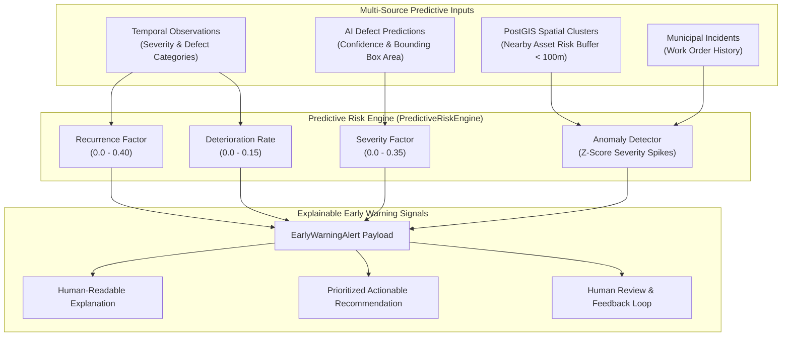

# NAGARLENS — Predictive Infrastructure Intelligence Architecture Specification

> **Product:** NAGARLENS Infrastructure Intelligence Network  
> **Document Version:** 1.0.0  
> **Status:** Active Production Specification  

---

## 1. High-Level Predictive Pipeline Topology

The NAGARLENS Predictive Intelligence Engine converts temporal asset records, computer vision defect assessments, spatial cluster densities, and historical work order incidents into explainable early warning signals.

---

## 2. Risk Calculation Formulation

The total predictive risk score $R \in [0.0, 1.0]$ is computed as:

$$R = \min\left(1.0, \, w_{\text{recurrence}} \cdot F_{\text{recurrence}} + w_{\text{severity}} \cdot S_{\text{latest}} + w_{\text{trend}} \cdot \Delta S + w_{\text{spatial}} \cdot R_{\text{neighbors}}\right)$$

Where:
- $F_{\text{recurrence}} = \min(0.40, N \cdot 0.08)$ (Inspection count factor)
- $S_{\text{latest}}$ = Latest photographic severity index (0.0 to 1.0)
- $\Delta S$ = Severity slope across consecutive inspections
- $R_{\text{neighbors}}$ = Average risk score of nearby assets within 100m catchment buffer
