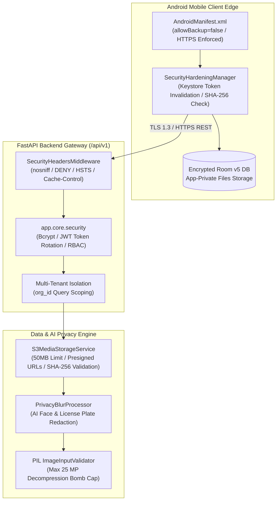

# NAGARLENS — Enterprise Security & Defense-in-Depth Architecture

> **Product:** NAGARLENS Infrastructure Intelligence Network  
> **Document Version:** 1.0.0  
> **Status:** Active Production Specification  

---

## 1. High-Level Defense-in-Depth Topology

NAGARLENS enforces security controls across client edge devices, API gateways, storage engines, and background automation frameworks.

---

## 2. Core Security Control Matrix

- **Client Storage**: `allowBackup="false"` in `AndroidManifest.xml` prevents ADB backups of private app storage.
- **Crypto & Secrets**: Production Pydantic Settings (`config.py`) rejects default development JWT keys in production environments.
- **Headers & CORS**: `SecurityHeadersMiddleware` sets `X-Content-Type-Options: nosniff`, `X-Frame-Options: DENY`, `Strict-Transport-Security`.
- **Media Uploads**: S3 presigned URLs validate SHA-256 media digests before committing database metadata.
- **Privacy Redaction**: `PrivacyBlurProcessor` redacts faces and vehicle license plates prior to public display.
