# NAGARLENS — Master Platform Testing & Quality Strategy

> **Product:** NAGARLENS Infrastructure Intelligence Network  
> **Document Version:** 1.0.0  
> **Status:** Active Production Specification  

---

## 1. Testing Strategy Topology

The NAGARLENS quality architecture spans native Android unit & Room database tests, Pytest backend REST API contract verification, AI preprocessor & NMS validation, spatial geodesic calculation checks, and performance benchmarks.

```mermaid
flowchart TD
    subgraph Android_Tests ["Android Client Test Suite (JUnit / Coroutines)"]
        UI_VM["Feature ViewModel Tests\n(MapViewModel, CaptureViewModel, ActivityViewModel)"]
        ROOM_TEST["Room Migration & Dao Tests\n(RoomAssetDaoTest, RoomEvidenceDaoTest, RoomMigrationTest)"]
        SPATIAL_TEST["SpatialQueryEngineTest\n(Haversine Distance & Bearing Math)"]
        BENCH_AND["PerformanceBenchmarkTest\n(10,000 Haversine ops < 50ms)"]
    end

    subgraph Backend_Tests ["Backend Python Test Suite (Pytest)"]
        API_TEST["FastAPI Endpoint Contract Tests\n(auth, assets, observations, incidents, investigations, sync)"]
        PRED_TEST["PredictiveRiskEngine & Anomaly Tests\n(Z-Score Spike Detection & Early Warnings)"]
        SEC_TEST["Security Hardening Tests\n(nosniff / DENY / HSTS Headers & PII Privacy Blur)"]
        BENCH_PY["test_performance_benchmarks.py\n(Latency < 15ms / FPS > 20)"]
    end

    UI_VM --> ROOM_TEST
    ROOM_TEST --> SPATIAL_TEST
    SPATIAL_TEST --> BENCH_AND

    API_TEST --> PRED_TEST
    PRED_TEST --> SEC_TEST
    SEC_TEST --> BENCH_PY
```

---

## 2. Test Execution Commands

- **Android Unit Tests**: `set ANDROID_PREFS_ROOT=&& gradlew.bat testDebugUnitTest` (64/64 Passed)
- **Backend Unit Tests**: `set PYTHONPATH=.&& pytest tests/unit` (65/65 Passed)
